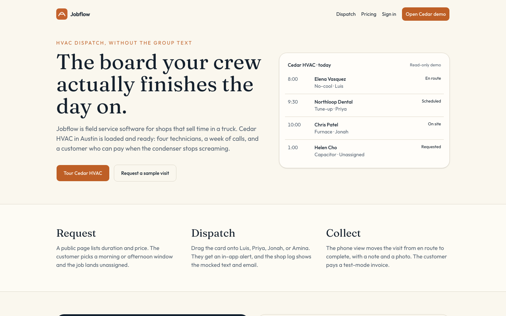
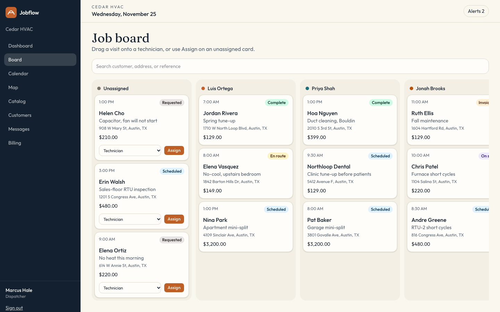
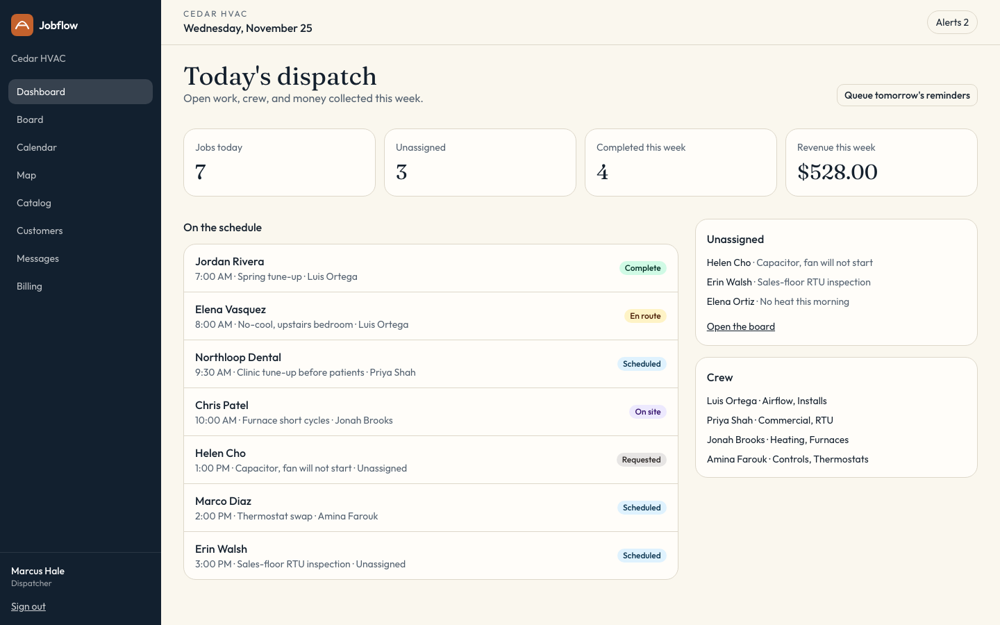
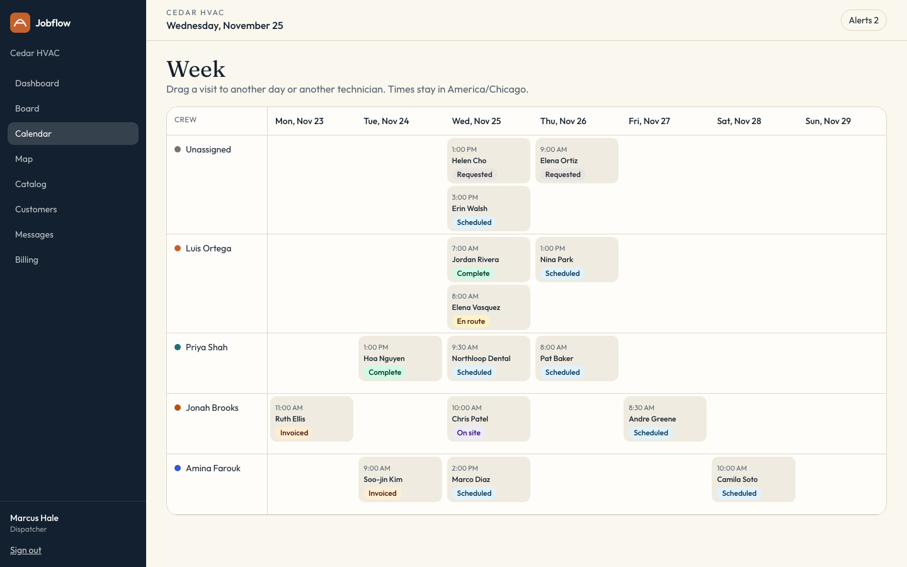
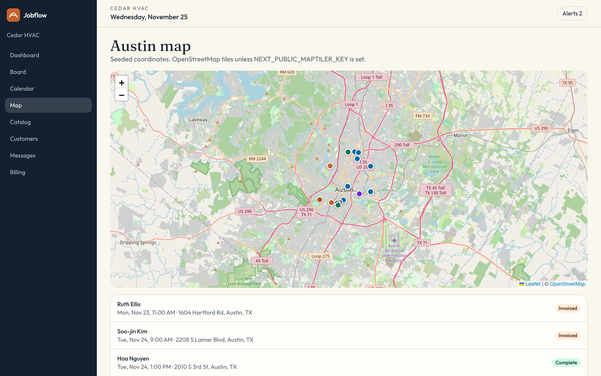
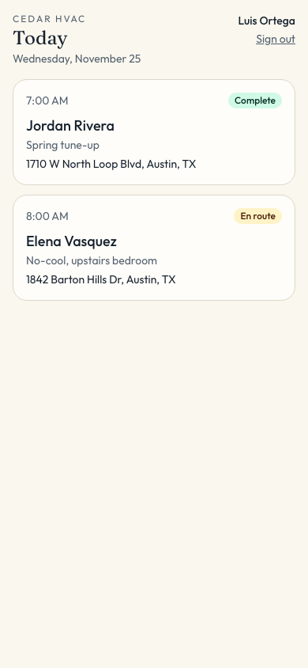
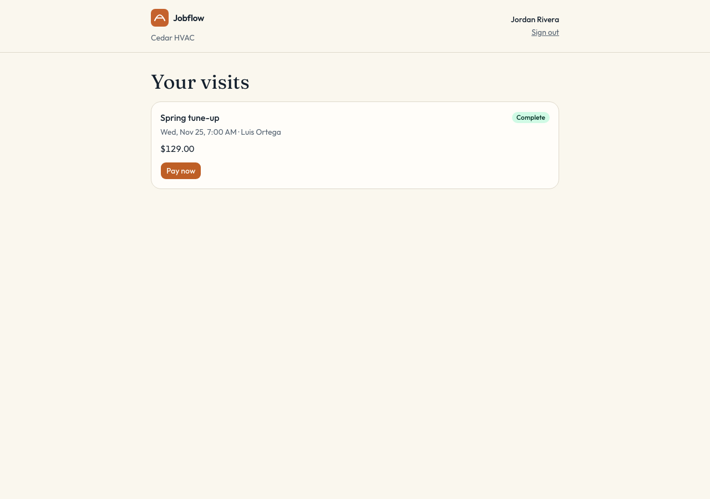
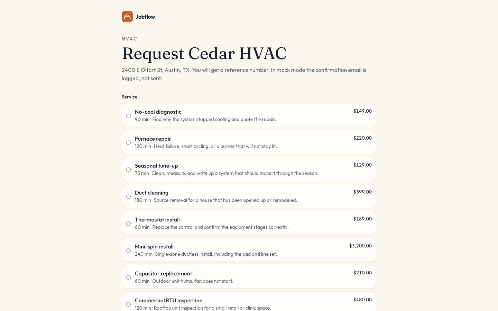

# Jobflow

Field service dispatch for trade shops. HVAC is the demo vertical: Cedar HVAC in Austin, four technicians, and a week of jobs across every status.

Jobflow runs with **zero environment variables**. Missing Supabase, Stripe, map, and model keys fall back to a seeded in-memory workspace, a mock checkout page, a message log, OpenStreetMap tiles, and a local job summary.



## What you can do

- Sign in as owner, dispatcher, technician, customer, or platform admin. Mock mode uses work email only.
- Publish a service catalog with duration and price.
- Take a public booking request and turn it into an unassigned job.
- Dispatch from a job board or a week calendar. Drag a visit onto a technician, or use Assign.
- Move a job through scheduled, en route, on site, complete, and invoiced.
- Give technicians a phone-first list of today, with notes and a photo.
- Let the customer open the portal and pay a completed job. Stripe test mode when a secret key is set, otherwise a mock card `4242`.
- Bill the shop on Starter ($49) or Pro ($149), test mode or mock.
- Keep in-app alerts plus a mocked email/SMS log for assignment, reminders, booking, and receipts.
- Read the dashboard: jobs today, unassigned, completed this week, revenue this week.
- See seeded Austin coordinates on a map.
- Ask for a job summary. Groq or Gemini when a key is present, otherwise a local draft.
- Open the platform admin and see every shop without entering their board.
- Tour Cedar HVAC in a public read-only demo.



## Screenshots

| | |
| --- | --- |
| Dashboard |  |
| Week |  |
| Map |  |
| Technician phone |  |
| Customer portal |  |
| Booking |  |

## Run locally

```bash
npm install
npm run dev
```

Open http://127.0.0.1:43123

Useful commands:

```bash
npm run build
npm run start
npm run typecheck
npm run lint
npm run test:e2e
```

Playwright starts the production server on port 43123. CI is `.github/workflows/ci.yml` and needs no secrets.

## Demo accounts

Mock mode has no passwords. On the sign-in page, continue as a person or type their email.

| Person | Email | Role | Shop |
| --- | --- | --- | --- |
| Dana Okonkwo | dana@cedarhvac.example | Owner | Cedar HVAC (Pro) |
| Marcus Hale | marcus@cedarhvac.example | Dispatcher | Cedar HVAC |
| Luis Ortega | luis@cedarhvac.example | Technician | Cedar HVAC |
| Priya Shah | priya@cedarhvac.example | Technician | Cedar HVAC |
| Jonah Brooks | jonah@cedarhvac.example | Technician | Cedar HVAC |
| Amina Farouk | amina@cedarhvac.example | Technician | Cedar HVAC |
| Elena Vasquez | elena@vasquez.example | Customer | Cedar HVAC |
| Jordan Rivera | jordan@rivera.example | Customer | Cedar HVAC |
| Lena Cho | lena@summitplumbing.example | Dispatcher | Summit Plumbing (Starter) |
| Owen Grant | owen@summitplumbing.example | Technician | Summit Plumbing |
| Quvantic Admin | platform@jobflow.example | Super-admin | Platform |

Public paths:

- `/` landing
- `/demo` read-only Cedar HVAC board
- `/book/cedar-hvac` booking request
- `/book/summit-plumbing` the other shop

A booking creates a customer who can sign in with the email they just used.

Times are America/Chicago. The seed rebuilds “today” when the server process starts, so the dashboard stays current.

## Environment variables

Copy `.env.example` to `.env.local`. Every variable is optional.

| Variable | When set |
| --- | --- |
| `AUTH_SECRET` | Signs the mock session cookie. Set a long random value before real tenant data. |
| `NEXT_PUBLIC_SUPABASE_URL` | Project URL. |
| `NEXT_PUBLIC_SUPABASE_PUBLISHABLE_KEY` | Publishable key. Legacy `NEXT_PUBLIC_SUPABASE_ANON_KEY` is also accepted. |
| `SUPABASE_SECRET_KEY` | Server only. Legacy `SUPABASE_SERVICE_ROLE_KEY` is also accepted. Required for public booking, invites, photo upload, and webhooks once Supabase is on. |
| `STRIPE_SECRET_KEY` | Stripe **test** secret. Checkout becomes real Stripe Checkout. |
| `STRIPE_WEBHOOK_SECRET` | Verifies `POST /api/stripe/webhook`. |
| `NEXT_PUBLIC_STRIPE_PUBLISHABLE_KEY` | Reserved for a future embedded Payment Element. Checkout uses the hosted page. |
| `STRIPE_PRICE_STARTER` / `STRIPE_PRICE_PRO` | Recurring price ids. Without them, subscription checkout uses inline price data. |
| `NEXT_PUBLIC_MAPTILER_KEY` | MapTiler streets tiles. Otherwise OpenStreetMap. |
| `GROQ_API_KEY` / `GROQ_MODEL` | Job summaries via Groq. Default model `llama-3.3-70b-versatile`. |
| `GEMINI_API_KEY` / `GEMINI_MODEL` | Used when Groq is unset. Default model `gemini-2.0-flash`. |
| `SEED_USER_PASSWORD` | Only for `scripts/seed-supabase.mjs`. |
| `NEXT_PUBLIC_APP_URL` | Optional public origin. Stripe return URLs use the request host when this is empty. |

Do not prefix the Supabase secret or the Stripe secret with `NEXT_PUBLIC_`. Do not commit `.env.local`.

When Supabase is configured, the public `/demo` route still opens the seeded mock workspace and stays read-only, so a live database is not exposed on the tour.

## Supabase

Schema, RLS, and the private `job-photos` bucket are in `supabase/migrations/20261125094610_jobflow_init.sql`.

Roles and tenant ids belong in `app_metadata`, not `user_metadata` (that claim is user-editable). The new-user trigger copies `role` and `tenant_id` from `raw_app_meta_data`.

Apply it with the Supabase CLI against the project you want:

```bash
npx supabase link
npx supabase db push
```

`app_private` holds the RLS helpers. Leave that schema out of the Data API exposed schemas.

There is no voice agent and no phone bot.

## Deploy

The app is a Next.js App Router project and deploys to Vercel with no environment variables. Target host: `jobflow.quvantic.com`.

```bash
npx vercel
```

Add the env vars above in the Vercel project when you are ready to leave mock mode. Point the Stripe webhook at `https://jobflow.quvantic.com/api/stripe/webhook`.

`GET /api/health` reports which backends are live (`mock` or `supabase`, `stripe`, `groq`, `gemini`, `maptiler`).

## Tests

`e2e/jobflow.spec.ts` covers:

1. A customer request becomes a job, a dispatcher assigns Luis, Luis completes it with a note and a photo, and mock payment succeeds.
2. Summit Plumbing cannot see Cedar HVAC jobs, including a direct job URL and `GET /api/jobs`.
3. `/demo` is read-only and `POST /api/jobs` returns 403.

```bash
npm run test:e2e
```
